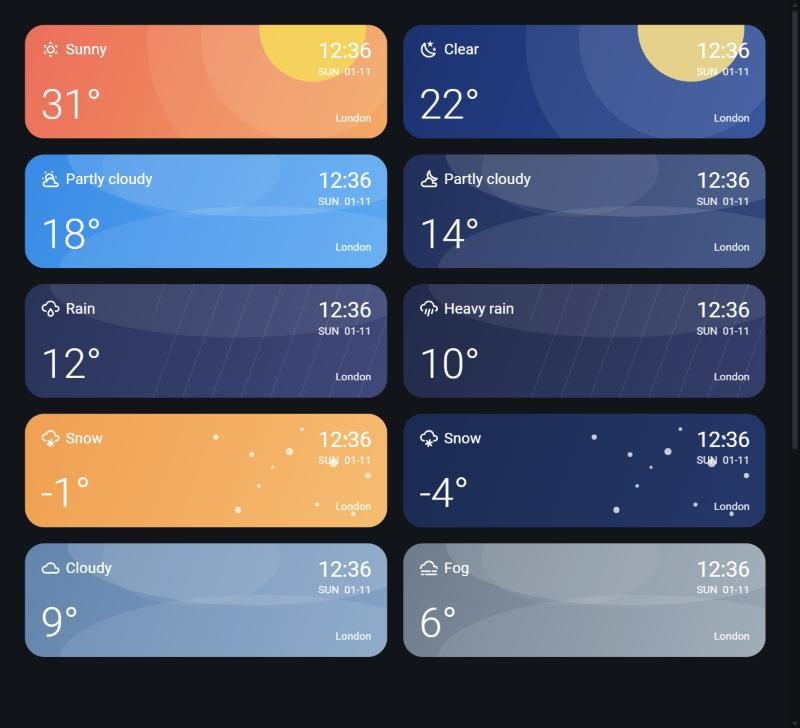

# Weather Banner card for Home Assistant

A "today" weather banner for Home Assistant dashboards. It shows the current condition, temperature, time, day and date, and a location label. The colours and artwork change with the weather and with day or night.

- **Sunny:** coral and orange with a sun. **Clear night:** deep blue with a moon.
- **Partly cloudy and cloudy:** soft cloud shapes, darker at night.
- **Rain, heavy rain and storms:** indigo with diagonal rain streaks.
- **Snow:** snowflakes on orange by day and navy at night.
- **Fog and windy** have their own looks too.

It's a single `custom:button-card` with no images, extra fonts or other plugins; the artwork is plain CSS shapes. It works with any `weather.*` entity and uses `sun.sun` for day and night. Tap it to open the full forecast.

## Requirements

- [button-card](https://github.com/custom-cards/button-card), installed through HACS.
- Optional: the **Time & Date** integration (Settings → Devices & services → Add integration → Time & Date → "Time"). It provides `sensor.time`, which makes the clock update every minute. Without it the clock still shows, but it only updates when Home Assistant redraws the card.

## Install

1. Edit your dashboard and add a **Manual** card.
2. Paste the contents of [`weather-banner.yaml`](weather-banner.yaml).
3. Change these values:

| Setting | What it is | Default |
|---|---|---|
| `entity` | Your weather entity | `weather.forecast_home` |
| `variables.location` | Text shown in the bottom right | `London` |
| `variables.sun` | Sun entity used for day and night | `sun.sun` |
| `variables.clock` | Time sensor | `sensor.time` |

The card is 128 px tall and spans the full width (`grid_options: columns: full`), which suits a sections dashboard.

## Customising

- **Colours:** each condition has its own gradient in the `looks` table inside the template.
- **Labels:** the first item of each `looks` entry is the text shown, for example `'Partly cloudy'`.
- **Date format:** change the `date` line near the end of the template.

## Licence

[MIT](LICENSE)
